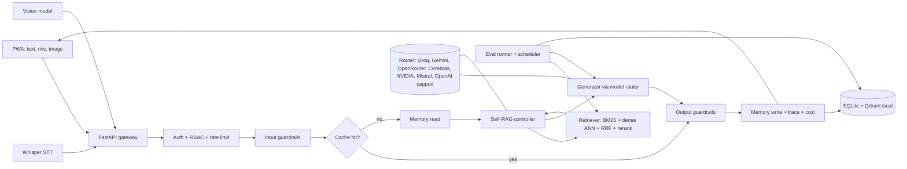

# 02. Technical Requirements Document

Status: draft design. Components are choices to validate by ablation, not claims of performance.

## 1. Architecture

## 2. Stack
| Concern | Choice | Why / alternative |
|---|---|---|
| Language | Python 3.12 | matches rag-demo (3.14 lacked ML wheels) |
| API | FastAPI + uvicorn | docs assistant for FastAPI, so it uses what it explains |
| Metadata DB | SQLite (SQLAlchemy) | zero cost; Postgres later if needed |
| Vector store | Qdrant embedded (local mode), HNSW | free, real ANN; cloud cluster optional via QDRANT_URL |
| ANN comparison | FAISS flat, IVF (k-means clusters), HNSW | evaluate recall vs latency vs memory |
| Sparse | BM25 (rank-bm25) | baseline from rag-demo |
| Embeddings | BAAI/bge-small-en-v1.5 baseline; test bge-base | ONNX via fastembed, CPU |
| Rerank | bge-reranker ONNX cross encoder | the MS MARCO cross encoder in rag-demo did not help; retest |
| STT | Groq Whisper large v3 (turbo) | free tier |
| TTS | browser Web Speech API | free, on device |
| Vision | Gemini Flash family via router | free tier, image capable |
| Cache | SQLite table + in memory LRU; optional Redis | semantic key = embedding similarity |
| Tracing | JSONL always; Langfuse if keys set | free tier |
| Frontend | PWA, framework chosen in phase 6 | no heavy build step preferred |
| Scheduler | GitHub Actions cron + admin endpoint | free |
| Deploy | Hugging Face Space (Docker, port 7860) | free CPU Space |

## 3. Ingestion
Fetch docs (markdown from the public repos), strip front matter, split by heading into **parent** sections and **child** chunks. Chunk size study: 128, 256, 512 tokens; overlap 0 and 15 percent; with and without contextual header (Page > Section). Images in docs get a caption from a vision model, stored as separate chunks with modality=image_caption. Each chunk stores source url, license, heading path, parent id, content hash for incremental re-index.

## 4. Retrieval
1. Query rewrite or HyDE (router small model), optional, ablated.
2. Candidates: BM25 top 50 + dense ANN top 50.
3. Fuse with Reciprocal Rank Fusion (k=60); MMR for diversity (ablated).
4. Rerank top 20 with a cross encoder, keep 5; expand to the parent section for context.
5. Index ablations: flat vs HNSW (M, ef) vs IVF (nlist, nprobe), measuring recall@k against exact search, latency, memory and build time.

## 5. Self-RAG (prompted, no fine tuning)
States: NEED_RETRIEVAL (skip for small talk), retrieve, RELEVANT per chunk (drop irrelevant), generate, SUPPORTED (claims grounded in kept chunks), USEFUL. If unsupported and attempts are under 2, rewrite the query and retry, else refuse. Each grade is a short structured JSON call to a small model. Cost and latency are logged so the benefit can be judged against plain RAG.

## 6. Model router
Task tiers: fast (rewrite, grade), answer, vision, stt, judge, embed (local). Config lists providers per tier in priority order. Behaviours: per provider RPM and RPD counters (defaults from docs/FREE-APIS.md), circuit breaker on 429 and 5xx, fallback to next provider, hard stop at OPENAI_BUDGET_USD, per call token and cost record. Adapters speak the OpenAI compatible API where possible; Gemini through its own or compat endpoint. Optional base URL for an external gateway (OmniRoute). The judge model family differs from the answer family.

## 7. Cache
Exact: hash of normalised question + role scope + index version. Semantic: cosine similarity above a threshold, tuned on the eval set so wrong hits are measured. Also caches embeddings and retrieval results. TTL and index version invalidation. Provider outage refusals are never cached. Per user memory content is never shared through the cache.

## 8. Memory
| Type | Content | Store | Lifetime |
|---|---|---|---|
| Short term | last N turns | request and session context | session |
| Session | rolling summary | sessions table | session |
| Long term semantic | facts and preferences the user stated | memories + vector | until deleted |
| Entity | named things (library versions, project) | memories kind=entity | until deleted |
| Episodic | past Q/A with feedback | memories kind=episode | retention window |
| Procedural | learned style rules (short answers, code first) | memories kind=procedure | until deleted |

Write policy: model proposes, rules filter (no secrets or PII), user can view and delete. Read: top k by recency x similarity, injected below the system prompt and labelled untrusted.

## 9. Guardrails
Input: injection patterns + classifier prompt, PII scan, length limits, off-topic via best chunk score. Retrieval: minimum score calibrated on the eval set. Output: citation present and resolvable, grounding check, no secret echo, refusal template. Role aware: guests get tighter limits. Every guardrail has a labelled eval set (phase 4).

## 10. Auth and RBAC (demo)
argon2 password hashes, JWT access (15 min) and refresh (7 days), roles, permissions and role_permissions tables. Roles: admin, developer, viewer, guest. Demo users are seeded by scripts/seed_users.py using passwords from env. Per role rate limit. Audit log of admin actions and denials. This is a demo of RBAC, not production identity.

## 11. API (draft)
POST /api/auth/login, /api/auth/refresh, /api/auth/logout. POST /api/ask, /api/ask-voice, /api/ask-image. GET /api/sources/:id. GET and DELETE /api/memories. GET /api/history. POST /api/feedback. GET /api/health. Admin: GET /api/admin/metrics, POST /api/admin/evals/run, GET /api/admin/evals/runs, GET and POST /api/admin/users.

## 12. Evals
Defined in docs/EVALS.md: retrieval, generation, RAG pipeline, full system, guardrails and safety, voice and image, and online (live traffic) evals. Scheduled runs write to eval_runs and eval_results and surface in the admin dashboard.

## 13. Observability and cost
Per request: trace id, user role, model per step, tokens in and out, latency per stage, cache status, fallback count, estimated cost (0 on free tiers, priced from the provider rate card for OpenAI). Aggregates feed the system eval.

## 14. Deployment
Docker image on a Hugging Face Space, secrets in Space settings. Index built at image build or boot. On this machine model downloads may need HF_HUB_DISABLE_XET=1. The Space disk is ephemeral: users and memories persist only if stored in a small private HF Dataset or re-seeded; this limitation is documented in the README. GitHub Actions run CI and cron evals with repository secrets.

## 15. Testing
pytest unit tests per package; contract tests with mocked providers; a small live smoke test gated by env; an eval regression gate in CI that fails when a metric drops beyond the tolerance set in docs/EVALS.md.

## 16. Risks
Space RAM for rerank plus embeddings (measure). Free tier quota exhaustion mid demo (cache, fallback and a visible notice). Judge bias. HNSW gains are invisible at about 1,000 chunks, so the ANN study also builds a larger synthetic set to make differences measurable, labelled as synthetic.
