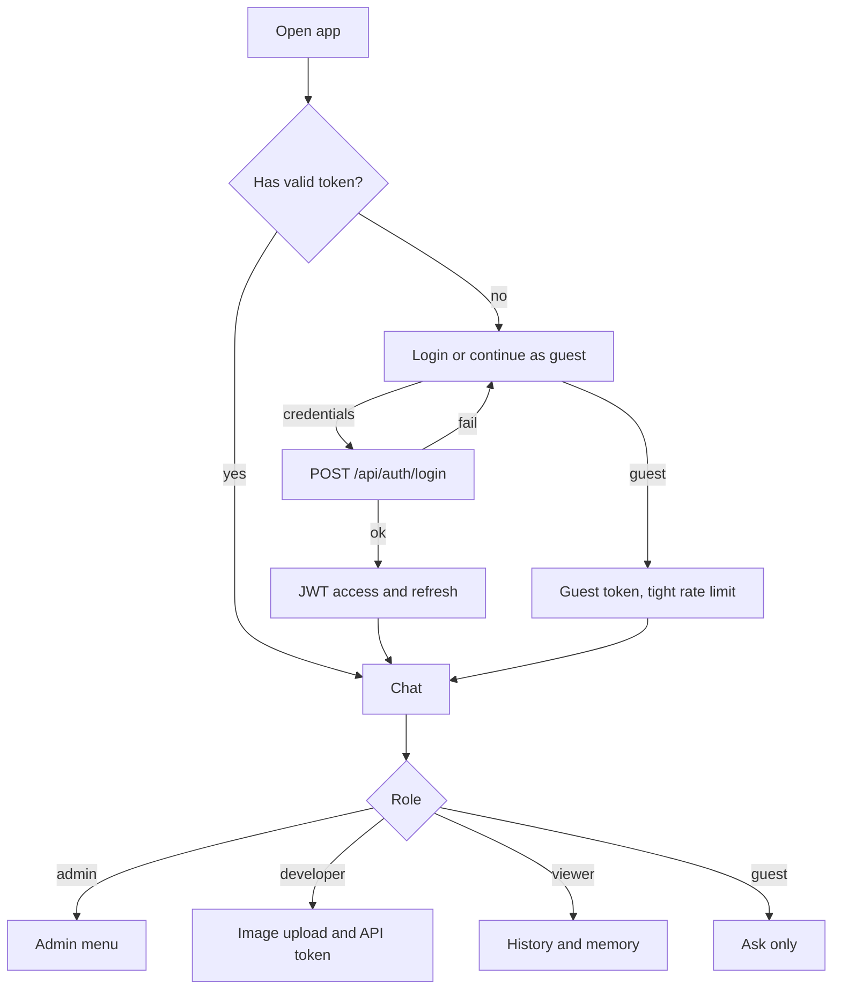
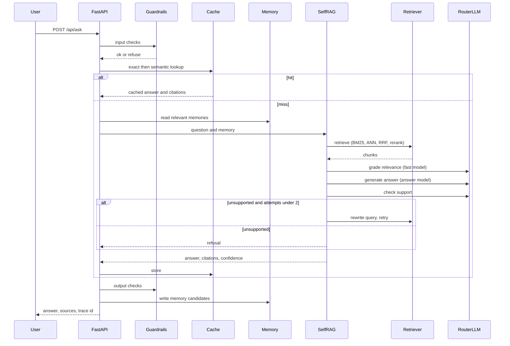
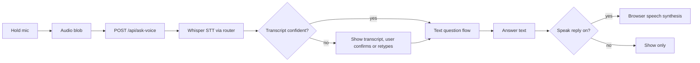
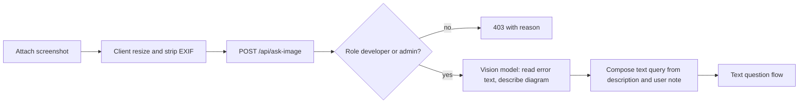
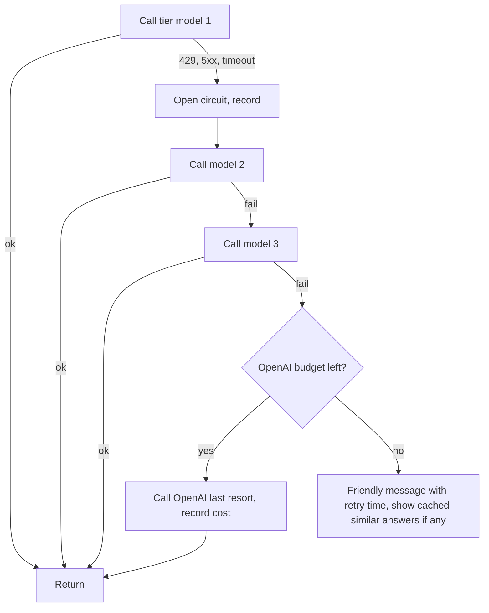
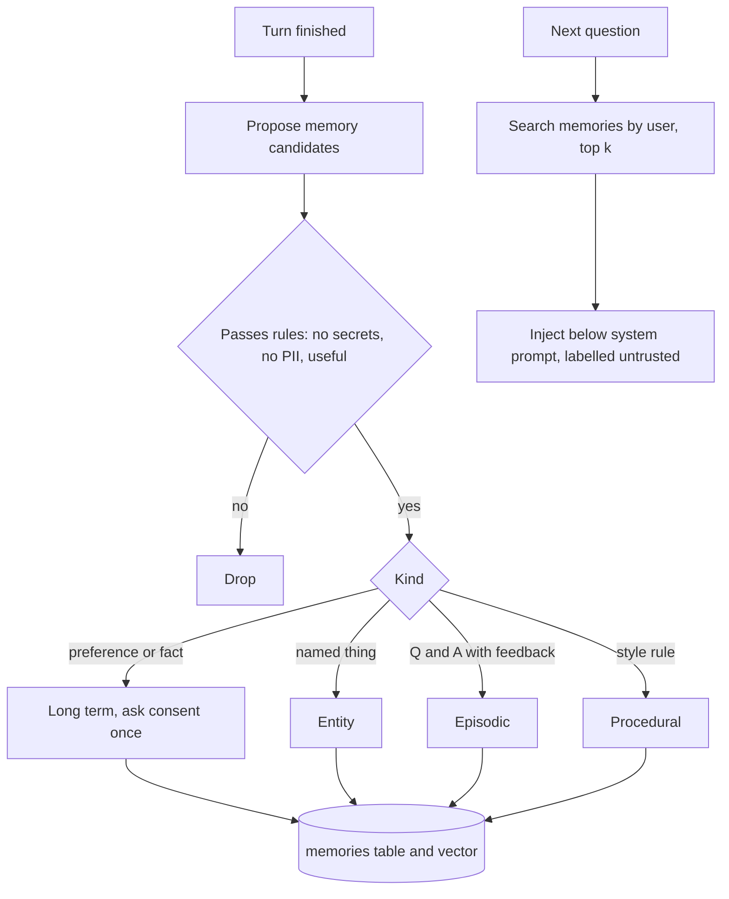
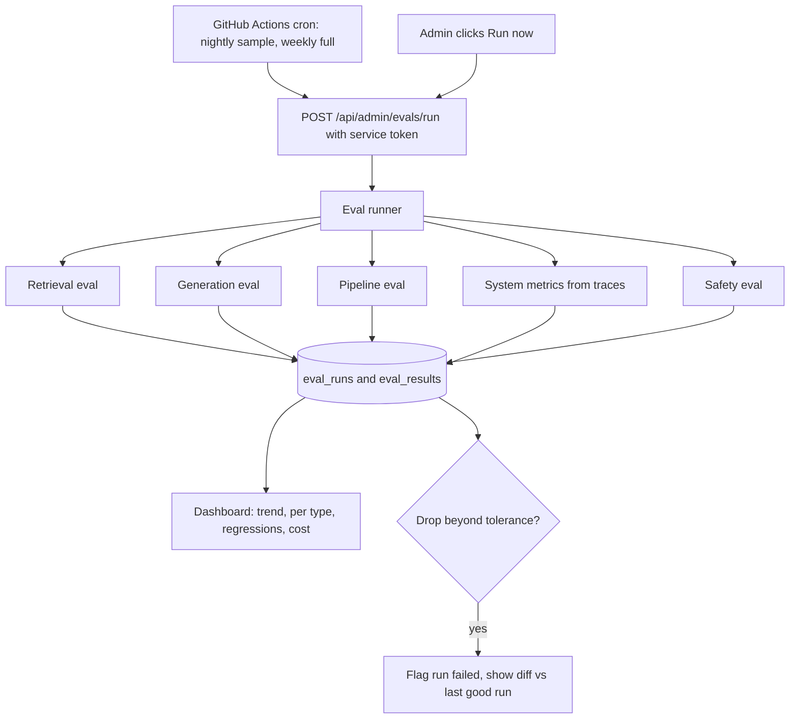

# 03. App Flow

Diagrams are the intended design. Nothing is implemented yet.

## 1. Screens
Login or guest entry, then Chat (text, mic, attach), Source drawer, History, Memory manager, Settings (voice, theme), and for admins: Users, Eval dashboard, System metrics.

## 2. Login and roles

## 3. Text question (main path)

## 4. Voice question

## 5. Image question

## 6. Provider fallback

## 7. Memory read and write

## 8. Admin eval dashboard and schedule

## 9. Error and edge states
- Provider quota exhausted: banner with retry time; cached answers still work.
- Space cold start: loading screen explaining the wake up.
- Off topic or unsupported: refusal with what was searched and a nearby doc link.
- Mic or camera denied: fall back to text and file picker with an explanation.
- Expired token: silent refresh, otherwise login with the draft question preserved.
