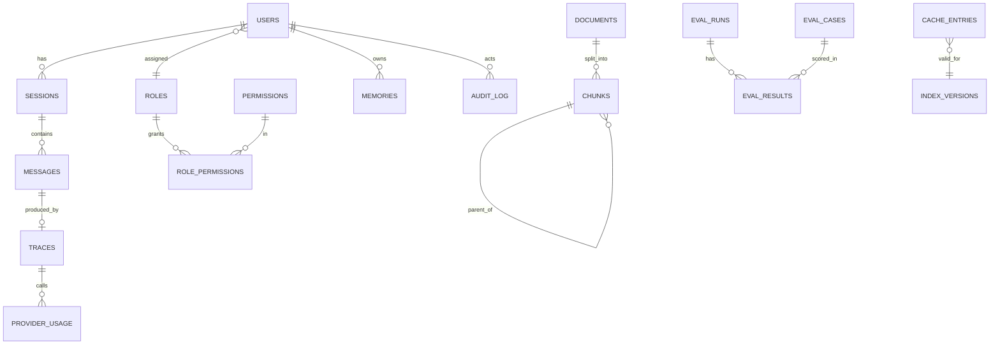

# 05. Backend Schema

Design only. SQLite for relational data, Qdrant (embedded) for vectors. Types are logical; exact DDL is written in phase 1 and 4 migrations.

## 1. ERD

## 2. Relational tables
| Table | Columns (key ones) | Notes |
|---|---|---|
| users | id, email unique, password_hash (argon2), role_id, is_active, created_at, last_login_at | demo users seeded from env passwords |
| roles | id, name unique (admin, developer, viewer, guest) | |
| permissions | id, code unique (ask, ask_image, view_history, manage_memory, run_evals, view_metrics, manage_users) | |
| role_permissions | role_id, permission_id | the RBAC matrix, seeded |
| refresh_tokens | id, user_id, token_hash, expires_at, revoked_at | store hash only |
| sessions | id, user_id nullable (guest), started_at, summary (rolling), summary_updated_at | |
| messages | id, session_id, role (user, assistant), content, modality (text, voice, image), feedback (-1, 0, 1), trace_id, created_at | audio and image bytes are not stored |
| memories | id, user_id, kind (long_term, entity, episode, procedure), content, embedding_id, source_message_id, consent bool, created_at, expires_at | deletable by the owner |
| documents | id, corpus (fastapi, pydantic), url, title, license, content_hash, fetched_at | |
| chunks | id, document_id, parent_id nullable, level (parent, child), heading_path, text, token_count, modality (text, code, image_caption), chunk_config_id, content_hash | |
| chunk_configs | id, size_tokens, overlap_pct, contextual_header bool, embedder, created_at | one row per ingestion experiment |
| index_versions | id, chunk_config_id, index_type (flat, hnsw, ivf), params json, built_at, n_vectors | cache keys include this id |
| cache_entries | id, key_hash, kind (exact, semantic, retrieval, embedding), query_text, query_embedding_id, value json, index_version_id, role_scope, hits, created_at, expires_at | |
| traces | id, message_id, started_at, role, cache_status, steps json (stage, model, latency_ms, tokens_in, tokens_out), total_latency_ms, total_tokens, est_cost_usd, fallback_count, refused bool, guardrail_flags json | feeds system evals |
| provider_usage | id, trace_id, provider, model, tier, tokens_in, tokens_out, latency_ms, status (ok, 429, 5xx, timeout), est_cost_usd, ts | quota counters read from here |
| eval_cases | id, dataset (golden, safety, synthetic), question, type, expected_pages json, reference_answer, answerable bool, source (hand, synthetic), reviewed bool | |
| eval_runs | id, kind (retrieval, generation, pipeline, system, safety, full), trigger (manual, nightly, weekly, ci), sample_size, config json, git_sha, started_at, finished_at, status | |
| eval_results | id, run_id, case_id nullable, metric, value, detail json | one row per metric per case or aggregate |
| audit_log | id, user_id, action, target, allowed bool, ip_hash, ts | admin actions and denials |

Indexes: users(email), messages(session_id, created_at), memories(user_id, kind), chunks(document_id), chunks(parent_id), cache_entries(key_hash), traces(started_at), provider_usage(provider, ts), eval_results(run_id, metric).

## 3. Vector collections (Qdrant)
| Collection | Vector | Payload |
|---|---|---|
| chunks_<index_version> | dense embedding, cosine, HNSW params from index_versions | chunk_id, document_id, parent_id, corpus, heading_path, modality |
| memories | dense embedding | memory_id, user_id, kind |
| semantic_cache | dense embedding of the question | cache_entry_id, index_version_id, role_scope |

BM25 index is built in memory from the chunks table at boot and saved as a pickle or JSON next to the index; it is rebuilt when index_version changes.

## 4. Permission matrix (seed)
| Permission | admin | developer | viewer | guest |
|---|---|---|---|---|
| ask | yes | yes | yes | yes (low rate) |
| ask_image | yes | yes | no | no |
| view_history | yes | yes | yes | no |
| manage_memory | yes | yes | yes | no |
| run_evals | yes | no | no | no |
| view_metrics | yes | yes | no | no |
| manage_users | yes | no | no | no |

Per role rate limits are config values to measure and tune, not fixed here.

## 5. Retention and privacy
Messages and memories deletable by owner; guest sessions purged after 24 h; traces keep no raw prompts beyond a truncated preview; audio and images are processed in memory and dropped; password hashes and refresh token hashes only; IPs stored hashed.

## 6. Migrations and seeding
Plain SQL migrations numbered in migrations/. scripts/seed_users.py creates roles, permissions and demo users with passwords from env; it refuses to run if a password is missing or shorter than 12 characters.

## 7. Open questions
Hugging Face Space persistence (dataset sync vs rebuild on boot). Whether to move to Postgres for the deployed version. Retention length for episodic memory.
